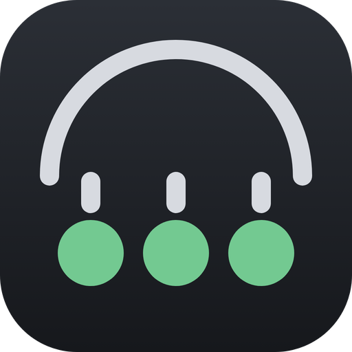
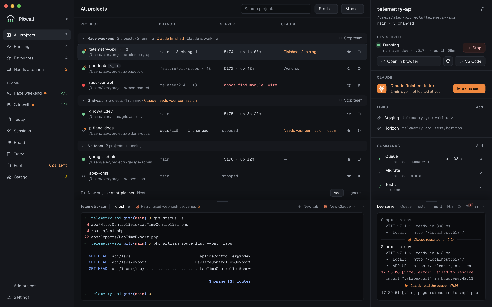
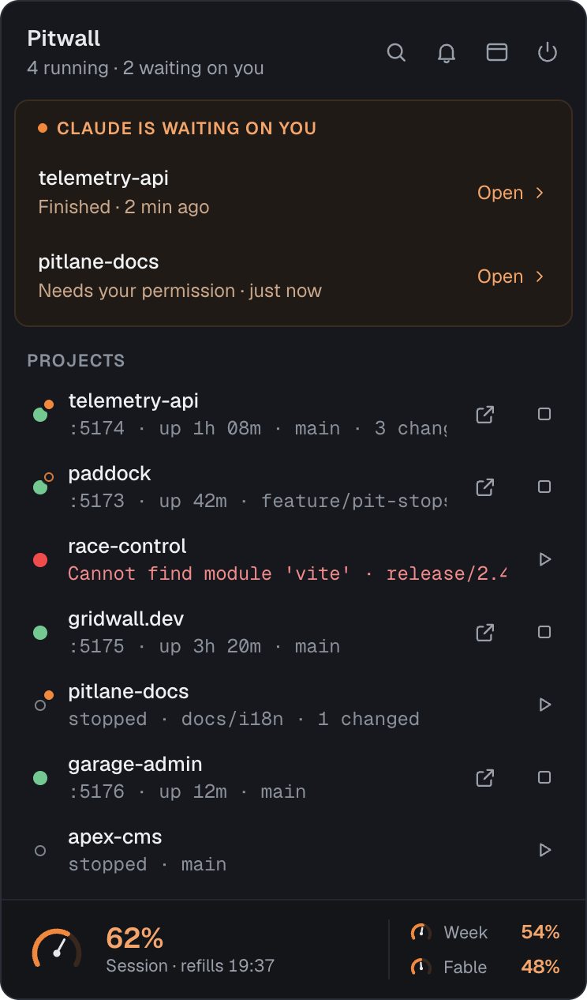
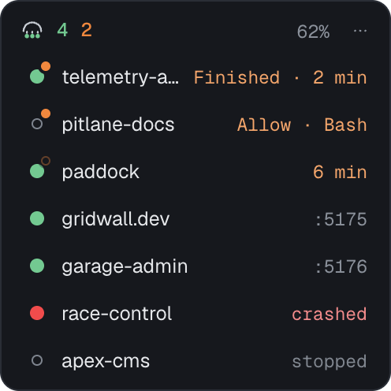
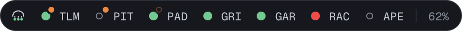
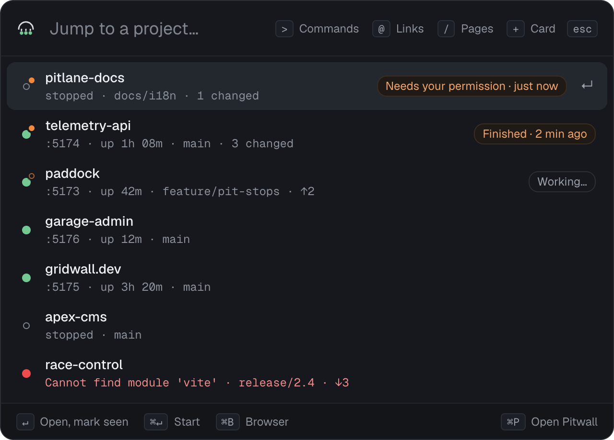
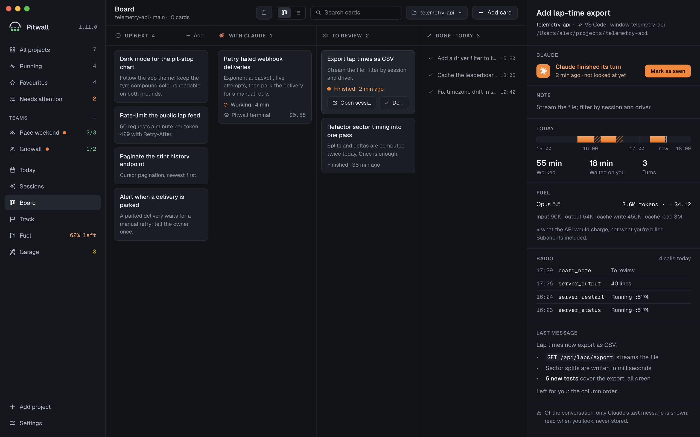
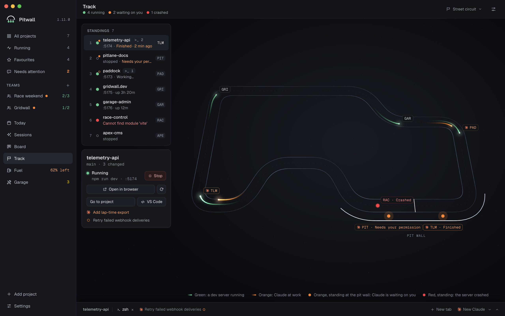
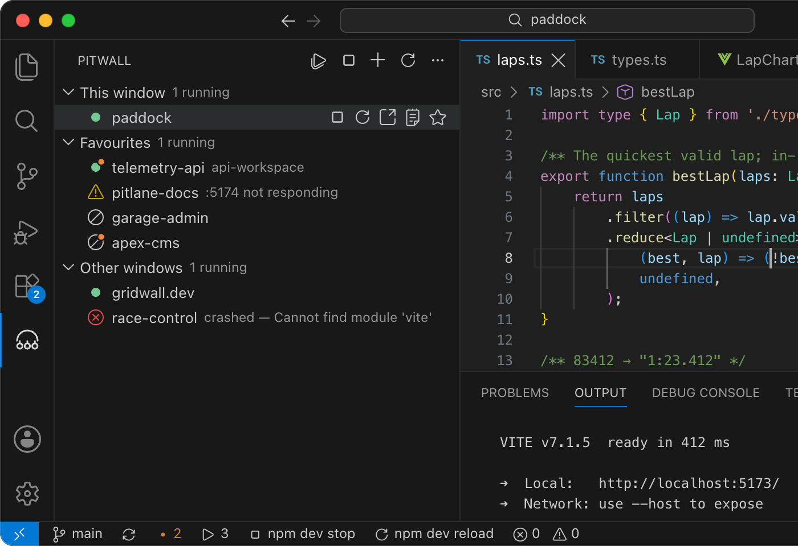

<div align="center">
  
  <h1>Pitwall</h1>
  <p>
    <b>The pit wall for your dev machine.</b><br>
    Your dev servers and Claude Code sessions, one glance away in the menu bar.
  </p>
  <p>
    <a href="https://github.com/aenzenith/pitwall/releases/latest"><b>Download</b></a> ·
    <a href="https://pitwall.aenzenith.com">Website</a> ·
    <a href="https://pitwall.aenzenith.com/docs">User guide</a> ·
    <a href="https://marketplace.visualstudio.com/items?itemName=aenzenith.pitwall-vscode">VS Code extension</a>
  </p>
  <sub>Free and open source · macOS, Windows and Linux · seven languages</sub>
</div>

<br>

<picture>
  <source media="(prefers-color-scheme: light)" srcset=".github/readme/projects-light.png">
  
</picture>

You hand work to Claude in five projects, switch to something else, and forget to come back.
Meanwhile every project wants its own `npm run dev`, ports collide, and a crashed server goes
unnoticed.

Pitwall runs every project's dev server and tells you the moment Claude Code is waiting on you. In
any project, with or without an editor open.

## Features

### Every server, one click away

Start, stop and restart any project from the menu bar, or start them all in the morning. A busy
port moves to the next free one, a crashed server comes back on its own, and stopping takes the
whole process tree with it. A production build is never run.

<p align="center">
  
</p>

### Know the moment it's your turn

Pitwall follows every Claude Code session, from the terminal or VS Code, and lights an orange dot
when one finishes, asks a question or needs your permission. One click brings that session up
where it was started: its editor tab, its terminal or its card on the board.

The **mini tower** keeps all of it on a second screen. It stays above every other window and never
takes the keyboard.

<p align="center">
  
  <br><br>
  
</p>

### Quick switcher

Press <kbd>⌃</kbd> <kbd>⌥</kbd> <kbd>P</kbd> anywhere (<kbd>Ctrl</kbd> <kbd>Alt</kbd> <kbd>P</kbd>
on Windows and Linux) and type. The projects Claude is waiting in come first: <kbd>↵</kbd> brings
that session up, or opens any other project in your editor.

<p align="center">
  
</p>

### The whole race in one window

A board per project, whose cards you hand to Claude and get back to review. A track where projects
lap a circuit and the ones that need you wait at the pit wall. The day's timeline, every session,
what is left of Claude's limits and each project's dependencies are a click away.

<table>
  <tr>
    <td width="50%"></td>
    <td width="50%"></td>
  </tr>
</table>

### Claude and your shell can ask too

- **Team radio.** Claude Code asks Pitwall about the dev server over MCP instead of starting one of
  its own, and can restart it or add a card to the board. Each tool has its own switch.
  *macOS and Linux.*
- **Command line.** `pitwall start`, `stop`, `logs -f` and `run` act on the project of the folder
  you are in. *macOS.*

### Lives in VS Code too

The [Pitwall extension](https://marketplace.visualstudio.com/items?itemName=aenzenith.pitwall-vscode)
shows every open window, its dev server and its Claude session in one panel, in VS Code, Cursor and
VS Code Insiders, with or without the app. When both run they share one view: start a server in the
editor, stop it from the menu bar. Source: [aenzenith/pitwall-vscode](https://github.com/aenzenith/pitwall-vscode).

<p align="center">
  
</p>

### Private by design

No account and no analytics. Claude Code's logs are read on your machine, never your prompts, and a
permission wait shows only the tool's name. Pitwall asks GitHub for its own updates and sends
nothing of yours along.

<br>

> Every page, setting and shortcut is in the [user guide](https://pitwall.aenzenith.com/docs).
> For the full tour, see [pitwall.aenzenith.com](https://pitwall.aenzenith.com).

## Install

Download the latest build from [Releases](https://github.com/aenzenith/pitwall/releases/latest).
Builds aren't signed yet, so the system asks once:

- **macOS 13+** (Apple Silicon, `.dmg`): drag Pitwall to Applications, then right-click it › Open › Open.
- **Windows 10/11** (`-setup.exe` or `.msi`): on the SmartScreen prompt, More info › Run anyway.
  Needs WebView2, which Windows 11 and an up-to-date Windows 10 already have.
- **Linux** (`.AppImage` or `.deb`): `chmod +x Pitwall_*.AppImage` and run it, or
  `sudo apt install ./Pitwall_*.deb`. Needs webkit2gtk-4.1 and a tray through AppIndicator (on
  GNOME, its extension); the tray icon opens a menu rather than the popover.

## Development

Needs Node 22 and stable Rust, plus per platform:

- **macOS**: Xcode Command Line Tools (`xcode-select --install`).
- **Windows**: Microsoft C++ Build Tools (Desktop development with C++) and WebView2.
- **Linux**: the packages in [`tools/linux-check/packages.txt`](tools/linux-check/packages.txt):
  `sudo apt install $(sed 's/#.*//' tools/linux-check/packages.txt)`.

```sh
npm ci
npm run tauri dev
npx vitest run && cargo test --manifest-path src-tauri/Cargo.toml
```

No Linux machine? `tools/linux-check/run.sh` runs the same checks as CI in Docker.

## Licence

[MIT](LICENSE)
